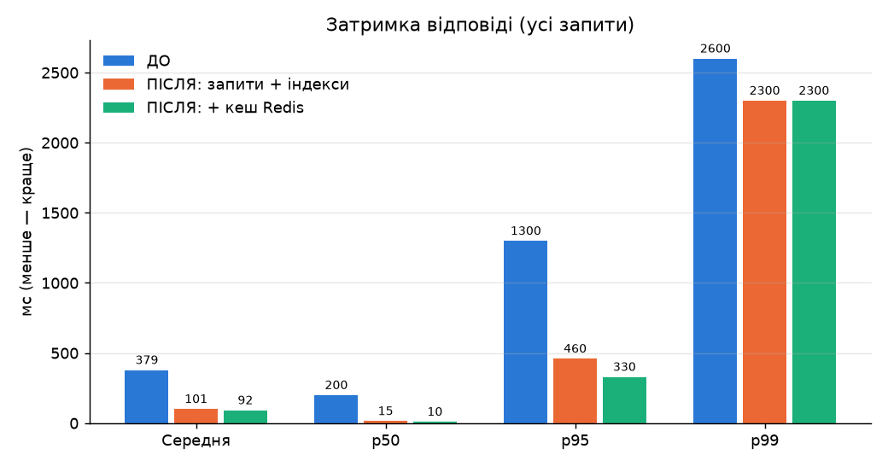
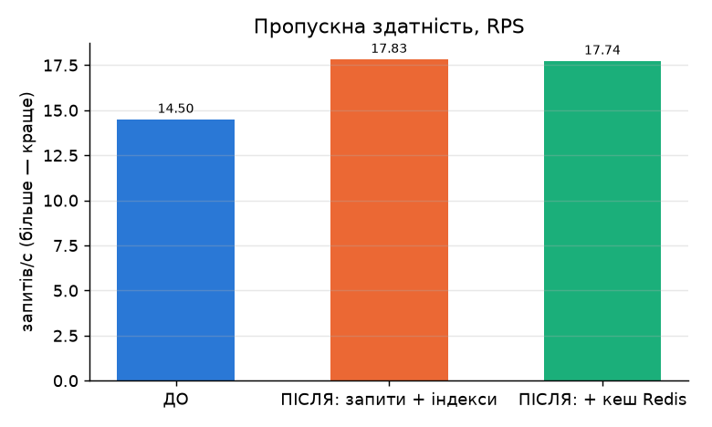
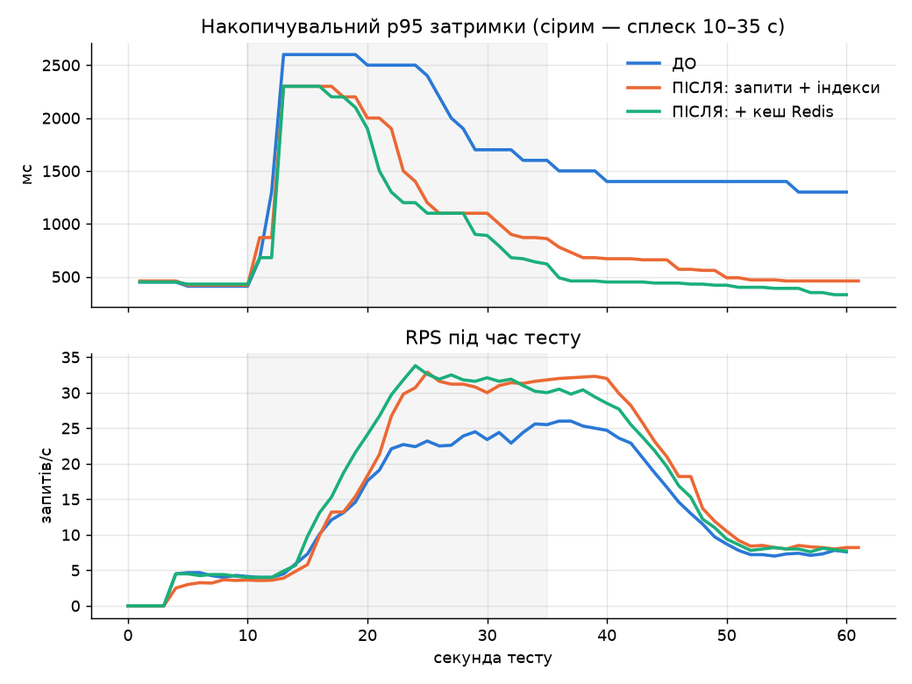
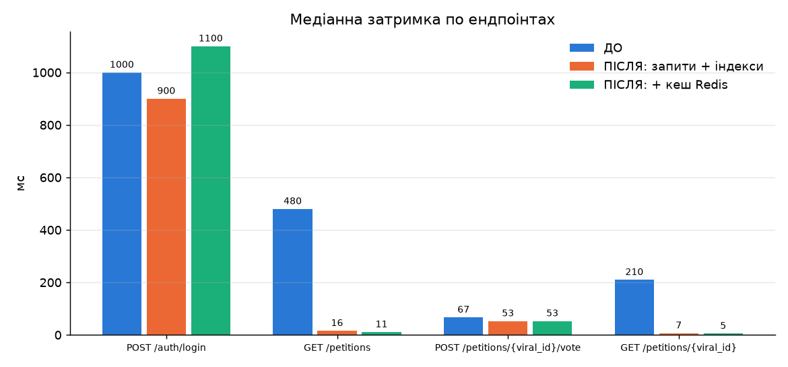
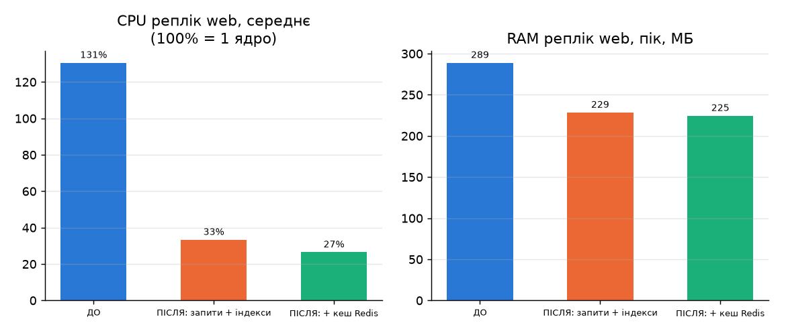

# ЗВІТ ПРО ВИКОНАННЯ ЛАБОРАТОРНОЇ РОБОТИ №7

**Тема:** Оптимізація продуктивності веб-системи.
**Мета:** Навчитися виявляти та усувати «вузькі місця» у коді та запитах до бази даних, застосувати практичні стратегії покращення швидкодії (оптимізація запитів, індексування, кешування) та оцінити їх ефективність порівняльним навантажувальним тестуванням.
**Проєкт:** Сервіс місцевих електронних петицій (`petitions-service`).
**Стек:** Python 3.11, FastAPI, SQLAlchemy 2.0 (async), PostgreSQL 16, **Redis 7**, Nginx (3 репліки бекенду з ЛР №6), Docker Compose, Locust 2.46, matplotlib.

---

## Що змінено (коротко)

| Файл | Зміна |
|---|---|
| `src/main.py` | Ендпоінти петицій: замість завантаження всіх голосів — один SQL-запит з `COUNT()`; кешування `GET /petitions/{id}` і `GET /petitions/` у Redis; інвалідація кешу після змін |
| `src/cache.py` | **Новий.** Три функції: `cache_get`, `cache_set` (з TTL), `cache_delete`. Без Redis застосунок працює як раніше |
| `src/models.py` | Індекс `ix_petitions_created_at`, складений індекс `ix_votes_petition_user (petition_id, user_id)` |
| `src/init_db.py` | `CREATE INDEX IF NOT EXISTS` — додає індекси і в уже існуючу БД |
| `src/config.py` | Налаштування `REDIS_URL` і `CACHE_TTL_SECONDS` (30 с) |
| `docker-compose.yml` | Новий сервіс `redis`, змінна `REDIS_URL` для `web` |
| `src/seed_load_data.py` | **Новий.** Наповнення БД реалістичним обсягом даних для тесту |
| `scripts/run_locust.py` | **Новий.** Запуск Locust (профіль ЛР №4) + збір CPU/RAM через `docker stats` |
| `scripts/explain_before.sql`, `scripts/explain_after.sql` | EXPLAIN ANALYZE запитів до та після |
| `scripts/make_lab7_charts.py` | Порівняльна таблиця й графіки `docs/lab7_*.png` |
| `tests/test_auth_access.py` | Новий тест: `votes_count` рахується правильно після оптимізації |

Результати тестів: `reports/lab7_before_*`, `reports/lab7_after_db_*`, `reports/lab7_after_cache_*`, плани запитів — `reports/lab7_explain_before.txt`, `reports/lab7_explain_after.txt`.

---

## 1. АНАЛІЗ «ВУЗЬКИХ МІСЦЬ»

### 1.1. Що показали попередні тести (ЛР №4, ЛР №6)

У ЛР №4 (сценарій «Telegram-вибух»: 60 % трафіку — `GET /petitions/1`, 40 % — голосування, 10 % — каталог) p95 під час сплеску сягав 6 с. У ЛР №6 після переходу на PostgreSQL і 3 репліки за Nginx p95 знизився до 1.3 с, але **медіана `GET /petitions` і `GET /petitions/1` залишалась сотні мілісекунд** — для простого читання одного запису це дуже багато.

### 1.2. Знайдена проблема №1 — «перевантаження» ORM (over-fetching, різновид N+1)

Старий код деталей петиції:

```python
query = select(Petition).options(selectinload(Petition.author), selectinload(Petition.votes)) \
                        .where(Petition.id == petition_id)
...
votes_count = len(petition.votes)   # <- тільки заради цього числа
```

`selectinload(Petition.votes)` виконує **окремий** запит `SELECT * FROM votes WHERE petition_id IN (1)` і перетворює **кожен** голос на Python-об'єкт `Vote`. Для вірусної петиції з 10 000 підписами це 10 000 ORM-об'єктів на **кожен** перегляд — лише щоб викликати `len()`. Каталог (`GET /petitions/`) був ще гіршим: він завантажував голоси **всіх** петицій (15 085 рядків) на кожен запит.

Тобто кількість роботи на запит зростає разом із кількістю голосів — чим популярніша петиція, тим повільніше вона відкривається. Саме в момент «Telegram-вибуху» це найнебезпечніше.

Ця ж конструкція повторювалась ще у `PUT /petitions/{id}` та `PATCH /petitions/{id}/status`.

### 1.3. EXPLAIN ANALYZE «ДО» (повний вивід — `reports/lab7_explain_before.txt`)

**Запит, який генерував `selectinload` для `GET /petitions/1`:**
```
Index Scan using ix_votes_petition_id on votes  (cost=0.29..362.55 rows=10001 width=85)
                                       (actual time=0.025..1.325 rows=10001 loops=1)
  Index Cond: (petition_id = 1)
Execution Time: 1.612 ms
```

**Каталог — сортування без індексу:**
```
Sort  (actual time=0.236..0.248 rows=203 loops=1)
  Sort Key: created_at DESC
  Sort Method: quicksort  Memory: 131kB
  ->  Seq Scan on petitions  (actual time=0.004..0.029 rows=203 loops=1)
```

**Голоси всіх петицій для каталогу:**
```
Hash Join  (actual time=0.124..3.469 rows=15085 loops=1)
  ->  Seq Scan on votes  (actual time=0.006..0.766 rows=15085 loops=1)
Execution Time: 3.931 ms
```

**Важливий висновок з EXPLAIN:** сам PostgreSQL виконує ці запити за **1.6–3.9 мс** — індекс на `petition_id` уже є і використовується. Отже, проблема **не в самій БД**, а в тому, що 10–15 тис. рядків (≈ 0.85–1.3 МБ) передаються мережею в застосунок і перетворюються на ORM-об'єкти. Саме це з'їдало CPU реплік (130 % CPU в середньому — див. розділ 5) і давало сотні мілісекунд затримки. Це добре показує, що **EXPLAIN аналізує лише частину шляху запиту** — потрібно дивитися і на те, скільки даних повертається в код.

### 1.4. Знайдена проблема №2 — повторне читання одних і тих самих даних

60 % трафіку сценарію — це читання **однієї й тієї ж** петиції. Під час сплеску 3 репліки сотні разів на хвилину виконують ідентичний запит до БД, хоча дані змінюються лише тоді, коли хтось успішно проголосував.

### 1.5. Знайдена проблема №3 — відсутні індекси

- `petitions.created_at` — використовується в `ORDER BY created_at DESC` каталогу, індексу не було → `Seq Scan + Sort`.
- Перевірка дубліката голосу `WHERE petition_id = ? AND (voter_signature_hash = ? OR user_id = ?)` використовувала окремі індекси й дофільтровувала рядки за `petition_id`.

### 1.6. Інші вузькі місця (свідомо не оптимізувались)

- **Bcrypt при логіні** — найважчий запит (~1 с медіана). Bcrypt навмисно повільний (захист від підбору пароля), послаблювати його не можна з міркувань безпеки. Саме логін формує «хвіст» p99 у всіх прогонах (див. розділ 6).

---

## 2. ОБРАНІ СТРАТЕГІЇ ТА ЇХ ОБҐРУНТУВАННЯ

| № | Стратегія | Проти якої проблеми | Чому саме вона |
|---|---|---|---|
| 1 | **Оптимізація запитів**: `COUNT()` у БД замість завантаження всіх голосів, автор через `JOIN` — один запит замість трьох | 1.2 | Усуває причину: обсяг роботи на запит перестає залежати від кількості голосів. Найпростіша зміна з найбільшим ефектом |
| 2 | **Кешування в Redis з TTL 30 с** для деталей петиції та каталогу | 1.4 | Сценарій — це сотні однакових читань. Redis спільний для всіх 3 реплік (на відміну від кешу в пам'яті процесу), а TTL гарантує, що навіть без інвалідації дані не будуть застарілими довше 30 с |
| 3 | **Індекси**: `ix_petitions_created_at`, складений `ix_votes_petition_user` | 1.5 | Дешево, без зміни логіки; захищає від деградації, коли таблиці виростуть |

---

## 3. МОДИФІКАЦІЯ СИСТЕМИ

### 3.1. Оптимізація запиту (`src/main.py`)

```python
def petitions_query():
    """ОДИН SQL-запит: петиція + ім'я автора + кількість голосів (COUNT у БД)."""
    votes_count = select(func.count(Vote.id)).where(Vote.petition_id == Petition.id) \
                                               .correlate(Petition).scalar_subquery()
    return select(Petition, User.username, votes_count).outerjoin(User, User.id == Petition.author_id)
```

Згенерований SQL:
```sql
SELECT petitions.*, users.username,
       (SELECT count(votes.id) FROM votes WHERE votes.petition_id = petitions.id) AS votes_count
FROM petitions LEFT OUTER JOIN users ON users.id = petitions.author_id
WHERE petitions.id = 1;
```

Тепер БД повертає **1 рядок** замість 10 003, а Python не створює жодного об'єкта `Vote`. Цей самий запит використовують каталог (з `ORDER BY`), `PUT` та `PATCH` петиції — дублювання коду формування відповіді прибрано функціями `to_response()` і `load_petition_response()`.

### 3.2. Шар кешування (`src/cache.py`)

```python
redis_client = redis.from_url(settings.REDIS_URL, decode_responses=True) if settings.REDIS_URL else None

async def cache_get(key):              # повертає dict/list або None
async def cache_set(key, value, ttl):  # SET key value EX ttl  (TTL = 30 с)
async def cache_delete(*keys):         # інвалідація після змін
```

Кожна функція обгорнута в `try/except`: якщо Redis впав, запит просто йде в БД (кеш — прискорювач, а не обов'язкова частина). Тести запускаються без Redis.

Використання в ендпоінті:
```python
@app.get("/petitions/{petition_id}")
async def get_petition_detail(petition_id: int, db = Depends(get_db)):
    cached = await cache_get(f"petition:{petition_id}")
    if cached is not None:
        return cached                                   # cache hit — БД не чіпаємо
    petition = await load_petition_response(db, petition_id)
    ...
    await cache_set(f"petition:{petition_id}", petition.model_dump(mode="json"))
    return petition
```

**Інвалідація** (щоб користувач одразу бачив свій голос):

| Подія | Що видаляється з кешу |
|---|---|
| Успішний голос, редагування, зміна статусу, видалення | `petition:{id}` і `petitions:list` |
| Створення петиції | `petitions:list` |

Відхилені дублікати голосів (`400 Duplicate vote`) кеш не скидають — дані не змінились.

### 3.3. Індекси (`src/models.py`, `src/init_db.py`)

```python
created_at = mapped_column(DateTime(timezone=True), default=get_utc_now, index=True)
...
Index("ix_votes_petition_user", "petition_id", "user_id"),
```

`Base.metadata.create_all` не додає індекси в **уже існуючі** таблиці, тому в `init_models()` вони створюються явно:
```python
await conn.exec_driver_sql("CREATE INDEX IF NOT EXISTS ix_petitions_created_at ON petitions (created_at)")
await conn.exec_driver_sql("CREATE INDEX IF NOT EXISTS ix_votes_petition_user ON votes (petition_id, user_id)")
```

### 3.4. Інфраструктура (`docker-compose.yml`)

```yaml
redis:
  image: redis:7-alpine
  healthcheck: { test: ["CMD", "redis-cli", "ping"] }

web:
  environment:
    REDIS_URL: ${REDIS_URL-redis://redis:6379/0}   # порожнє значення вимикає кеш
  depends_on:
    redis: { condition: service_healthy }
```

### 3.5. Бізнес-логіка не порушена

- Усі старі тести (RBAC, IDOR, голосування, модерація, конфігурації) проходять.
- Додано тест `test_lab7_votes_count_after_optimization`: 2 голоси → `votes_count == 2` і в деталях, і в каталозі, правильний `author_username`.

```
venv\Scripts\python -m pytest -q
13 passed
ruff check src tests  ->  All checks passed!
```

- Вручну: `GET /petitions/1` повертає `"votes_count": 10003` — те саме число, що й до оптимізації.
- Формат JSON-відповідей не змінився, веб-інтерфейс працює без змін.

---

## 4. МЕТОДИКА ПОВТОРНОГО ТЕСТУВАННЯ

**Інструмент і профіль — ті самі, що в ЛР №4:** Locust, `locustfile.py` без змін, `TelegramSpikeLoadShape` (0–10 с: 5 користувачів → 10–35 с: сплеск до 40 користувачів, spawn rate 20/с → 35–60 с: 10 користувачів), пауза 0.5–2 с.

**Середовище:** архітектура з ЛР №6 — `Locust → nginx:80 → 3 репліки web → PostgreSQL` (+ Redis), Docker Desktop, Windows 11, один комп'ютер.

**Дані:** щоб тест відображав реальну ситуацію «вірусної» петиції, БД наповнено скриптом `src/seed_load_data.py` (фіксований `random.seed(42)`):
- 203 петиції в каталозі;
- 15 083 голоси, з них **10 000 — на петиції №1** (та, на яку «посилається Telegram»).

Без цього таблиця `votes` містила б лише кілька рядків і проблема з п. 1.2 не була б помітна — але в реальній системі вона проявилась би саме тоді, коли петиція стала популярною.

**Три прогони на одній і тій самій БД**, щоб окремо виміряти внесок кожного заходу:

| Прогін | Код | Redis | Файли |
|---|---|---|---|
| ДО | код ЛР №6 | — | `reports/lab7_before_*` |
| ПІСЛЯ-1 | оптимізовані запити + індекси | вимкнено (`REDIS_URL=""`) | `reports/lab7_after_db_*` |
| ПІСЛЯ-2 | оптимізовані запити + індекси | **увімкнено** | `reports/lab7_after_cache_*` |

**CPU / RAM** знімались паралельно з тестом кожні ~2 с командою `docker stats` (`scripts/run_locust.py` → `*_resources.csv`). CPU у Docker вимірюється у відсотках одного ядра (100 % = 1 ядро повністю).

> **Примітка про «ДО».** Цифри ЛР №4 отримані на іншій архітектурі (SQLite, 1 процес), тому для чесного порівняння «ДО» виміряно заново на поточній архітектурі й тих самих даних, що й «ПІСЛЯ».

---

## 5. РЕЗУЛЬТАТИ: ПОРІВНЯЛЬНА ТАБЛИЦЯ

### 5.1. Загальні метрики (рядок `Aggregated`)

| Метрика | ДО | ПІСЛЯ-1: запити + індекси | ПІСЛЯ-2: + кеш Redis | Зміна ДО → ПІСЛЯ-2 |
|---|---|---|---|---|
| Запитів за тест | 875 | 1076 | 1072 | **+23 %** |
| **RPS** | 14.50 | 17.83 | 17.74 | **+22 %** |
| **Середня затримка**, мс | 379 | 101 | 92 | **−76 %** |
| Медіана p50, мс | 200 | 15 | 10 | **−95 % (у 20 разів)** |
| **p95**, мс | 1300 | 460 | 330 | **−75 %** |
| p99, мс | 2600 | 2300 | 2300 | −12 % |
| Максимум, мс | 3729 | 3221 | 2769 | −26 % |
| **Error Rate** | 0 % | 0 % | 0 % | — |

### 5.2. Ресурси (сума 3 реплік `web`)

| Метрика | ДО | ПІСЛЯ-1 | ПІСЛЯ-2 | Зміна |
|---|---|---|---|---|
| **CPU web, середнє** | 130.6 % | 33.4 % | 26.5 % | **−80 %** |
| CPU web, пік | 296.7 % | 279.2 % | 270.5 % | −9 % |
| CPU PostgreSQL, середнє | 8.1 % | 5.0 % | 2.8 % | −65 % |
| **RAM web, середнє** | 266.9 МБ | 216.2 МБ | 215.7 МБ | **−19 %** |
| RAM web, пік | 289.0 МБ | 228.5 МБ | 224.6 МБ | −22 % |
| RAM PostgreSQL, середнє | 96.8 МБ | 97.1 МБ | 92.2 МБ | ≈ |

### 5.3. Медіанна затримка по ендпоінтах, мс

| Ендпоінт | Частка трафіку | ДО | ПІСЛЯ-1 | ПІСЛЯ-2 | Прискорення |
|---|---|---|---|---|---|
| `GET /petitions/1` (вірусна петиція) | ~50 % | 210 | 7 | **5** | **у 42 рази** |
| `GET /petitions` (каталог) | ~10 % | 480 | 16 | **11** | **у 44 рази** |
| `POST /petitions/1/vote` | ~37 % | 67 | 53 | 53 | −21 % |
| `POST /auth/login` (bcrypt) | ~4 % | 1000 | 900 | 1100 | ≈ (не оптимізувався) |

> **Чому голосування має «підлогу» 53 мс.** Перевірка `curl` показала, що сервер відповідає на `POST /vote` за ~10 мс; ще ~40 мс додає сам Python-клієнт (бібліотека `requests`, на якій побудовано Locust) на Windows через затримку TCP-підтвердження для POST-запитів з тілом. Це артефакт клієнта, однаковий в усіх прогонах, тому на порівняння не впливає.

---

## 6. ГРАФІКИ

### 6.1. Затримка (середня, p50, p95, p99)


### 6.2. Пропускна здатність


### 6.3. Динаміка під час тесту


Видно, що під час сплеску (сіра зона) «ДО» досягає стелі ~25 RPS — сервер не встигає, і запити накопичуються в черзі. Після оптимізації система тримає ~32 RPS, тобто **встигає обслуговувати всіх 40 користувачів** з тією швидкістю, з якою вони надсилають запити. Після сплеску p95 «ПІСЛЯ» швидко падає, а «ДО» так і залишається високим.

### 6.4. Медіана по ендпоінтах


### 6.5. CPU та RAM


---

## 7. ГЛИБОКИЙ АНАЛІЗ ЗАПИТІВ (EXPLAIN ANALYZE) — ДО / ПІСЛЯ

Повні плани: `reports/lab7_explain_before.txt`, `reports/lab7_explain_after.txt`.

### 7.1. Деталі петиції `GET /petitions/1`

**ДО** — окремий запит повертає в застосунок **10 001 рядок** (width=85 байт → ≈ 850 КБ):
```
Index Scan using ix_votes_petition_id on votes (actual time=0.025..1.325 rows=10001 loops=1)
  Index Cond: (petition_id = 1)
Execution Time: 1.612 ms
```
плюс ще 2 запити: сама петиція та автор.

**ПІСЛЯ** — один запит, підрахунок усередині БД, у застосунок повертається **1 рядок**:
```
Nested Loop Left Join  (actual time=1.429..1.436 rows=1 loops=1)
  ->  Index Scan using ix_petitions_id on petitions  (rows=1)
        Index Cond: (id = 1)
  ->  Seq Scan on users  (rows=2)
  SubPlan 1
    ->  Aggregate  (actual time=1.405..1.405 rows=1 loops=1)
          ->  Index Scan using ix_votes_petition_id on votes  (rows=10003)
                Index Cond: (petition_id = petitions.id)
Execution Time: 1.542 ms
```

Час у БД практично однаковий (1.6 → 1.5 мс), але **результат зменшився з 10 001 рядка до 1**. Саме тому медіана ендпоінту впала з 210 мс до 7 мс: зник час на передачу даних і створення 10 000 Python-об'єктів. (`Seq Scan on users` — нормально: у таблиці 3 рядки, читати індекс дорожче, ніж усю таблицю.)

### 7.2. Каталог `GET /petitions/`

**ДО:** `Seq Scan` + `Sort (quicksort 131kB)` по петиціях, плюс `Hash Join` з **15 085** голосами (3.9 мс у БД, 15 085 рядків у застосунок).

**ПІСЛЯ:**
```
Nested Loop Left Join  (actual time=0.070..2.707 rows=203 loops=1)
  ->  Index Scan Backward using ix_petitions_created_at on petitions  (rows=203)
  ->  Memoize  (Hits: 201  Misses: 2)
        ->  Index Scan using ix_users_id on users
  SubPlan 1
    ->  Aggregate  (loops=203)
          ->  Index Scan using ix_votes_petition_id on votes  (rows=74 loops=203)
Execution Time: 2.797 ms
```
- Новий індекс `ix_petitions_created_at` використовується: **`Index Scan Backward` замінив `Sort`** — дані читаються одразу у порядку `DESC`.
- PostgreSQL сам кешує автора (`Memoize`: 201 попадання з 203).
- У застосунок повертається 203 рядки замість 203 + 15 085.

### 7.3. Перевірка дубліката голосу `POST /petitions/1/vote`

**ДО:**
```
BitmapOr
  ->  Bitmap Index Scan on ix_votes_voter_signature_hash
  ->  Bitmap Index Scan on ix_votes_user_id          Index Cond: (user_id = 2)
Filter: (petition_id = 1)
Rows Removed by Filter: 1          <- знайдено голос користувача за ІНШУ петицію, відкинуто
```
**ПІСЛЯ:**
```
BitmapOr
  ->  Bitmap Index Scan on ix_votes_voter_signature_hash
  ->  Bitmap Index Scan on ix_votes_petition_user    Index Cond: ((petition_id = 1) AND (user_id = 2))
```
Складений індекс перевіряє обидві умови одразу, без зайвих рядків, які потім відкидаються. Для активного користувача з сотнями голосів за різні петиції це заощадить читання з диска.

### 7.4. Чесна оцінка індексів

На поточному обсязі (203 петиції) індекси дали виграш у **частки мілісекунди** — у навантажувальному тесті він непомітний. Їхня цінність — у масштабуванні: при 100 000 петицій `Sort` усієї таблиці коштував би десятки мілісекунд, а `Index Scan Backward` + `LIMIT` залишився б миттєвим. Головний висновок EXPLAIN — **проблема була не у швидкості БД, а в обсязі даних, що повертався в застосунок.**

---

## 8. ДОДАТКОВЕ ЗАВДАННЯ: ШАР КЕШУВАННЯ REDIS

### 8.1. Що кешується

| Ключ | Що зберігає | TTL |
|---|---|---|
| `petition:{id}` | JSON деталей петиції | 30 с |
| `petitions:list` | JSON повного каталогу (без фільтрів пошуку) | 30 с |

Пошук із фільтрами (`?q=...`, `?status=...`) не кешується — комбінацій багато, а запитів мало.

### 8.2. Перевірка роботи кешу

```powershell
curl http://localhost/petitions/1
docker compose -p petitions-lab7 exec redis redis-cli KEYS '*'
# petition:1
docker compose -p petitions-lab7 exec redis redis-cli TTL petition:1
# 29        <- запис зникне сам через 29 с
```

### 8.3. Ефективність під навантаженням

Статистика Redis за прогін ПІСЛЯ-2 (`redis-cli INFO stats`):
```
keyspace_hits:639
keyspace_misses:4
```
**Hit rate = 639 / 643 = 99.4 %** — лише 4 запити з 643 читань дійшли до PostgreSQL (перше звернення до ключа, а також після інвалідації чи закінчення TTL).

Ефект кешу (ПІСЛЯ-1 → ПІСЛЯ-2):
- `GET /petitions/1`: медіана 7 → 5 мс, каталог 16 → 11 мс;
- p95 загальний: 460 → 330 мс (**−28 %**);
- CPU PostgreSQL: 5.0 → 2.8 % (**−44 %**) — БД майже не навантажується читаннями;
- CPU web: 33 → 27 %.

---

## 9. ВИСНОВКИ

### 9.1. Який захід дав найбільший приріст

| Захід | Середня затримка | p95 | CPU web |
|---|---|---|---|
| ДО | 379 мс | 1300 мс | 131 % |
| **+ оптимізація запитів та індекси** | **101 мс (−73 %)** | **460 мс (−65 %)** | **33 % (−74 %)** |
| + кеш Redis | 92 мс (ще −9 %) | 330 мс (ще −28 %) | 27 % (ще −21 %) |

**Найбільший приріст дала оптимізація запитів** — заміна `selectinload(Petition.votes)` + `len()` на `COUNT()` у БД. Вона забезпечила ~97 % загального зменшення середньої затримки (278 із 287 мс) і ~87 % зменшення p95. Причина — було усунено головну неефективність: обсяг роботи на один запит більше не залежить від кількості голосів (10 000 рядків → 1 рядок).

**Кеш Redis** дав другий за величиною ефект, найпомітніший на «хвостах» (p95 −28 %) і на навантаженні БД (−44 % CPU PostgreSQL). Його цінність зростатиме з кількістю реплік і користувачів: усі репліки читають один спільний кеш, і БД обробляє лише ~1 % запитів на читання.

**Індекси** на поточному обсязі даних майже не вплинули на метрики тесту, але EXPLAIN підтверджує, що вони використовуються і захищають систему від деградації при зростанні таблиць.

### 9.2. Загальний результат

- **RPS: 14.5 → 17.7 (+22 %)**, за той самий час оброблено на 23 % більше запитів. Під час піку система тримає ~32 RPS замість ~25, тобто більше не є «вузьким місцем» для 40 користувачів (RPS тепер обмежує сам сценарій — паузи 0.5–2 с між діями користувачів, як і зазначалося в ЛР №6).
- **Середня затримка −76 %, медіана у 20 разів менша, p95 −75 %.**
- **CPU застосунку −80 %, RAM −22 %** — та сама робота виконується значно меншими ресурсами, тобто запас потужності для більшого трафіку зріс у кілька разів.
- **Error Rate 0 %** в усіх прогонах, бізнес-логіка збережена (13/13 тестів).

### 9.3. Що лишилось і що робити далі

- **p99 (~2.3 с) і пік CPU (~280 %) майже не змінились** — їх формує логін із bcrypt, коли 35 нових користувачів з Telegram одночасно входять у систему. Це свідома ціна безпеки. Варіанти: довше життя JWT-токена (менше повторних логінів), окремий сервіс автентифікації або горизонтальне масштабування тільки його.
- Для запису голосів під дуже великим навантаженням — асинхронна черга (Redis Streams / RabbitMQ), як запропоновано в ЛР №4.
- Лічильник голосів можна зберігати в окремій колонці `petitions.votes_count`, що оновлюється при голосуванні, — тоді навіть `COUNT()` по 10 000 рядків не потрібен.

---

## 10. ЯК ПРОДЕМОНСТРУВАТИ РОБОТУ

Усі команди — з кореня проєкту в PowerShell. Окремий проєкт `-p petitions-lab7` не чіпає вашу основну БД.

**1. Запуск стеку з Redis і наповнення даними**
```powershell
docker compose -p petitions-lab7 -f docker-compose.yml up -d --build
docker compose -p petitions-lab7 exec web python -m src.seed_load_data
docker compose -p petitions-lab7 ps          # db, redis, web x3, nginx — healthy
```

**2. Показати, що все працює і кількість голосів правильна**
```powershell
curl http://localhost/petitions/1            # "votes_count": 10003
venv\Scripts\python -m pytest -q             # 13 passed
```

**3. Показати кеш Redis і TTL**
```powershell
docker compose -p petitions-lab7 exec redis redis-cli KEYS '*'           # petition:1
docker compose -p petitions-lab7 exec redis redis-cli TTL petition:1     # ~30 -> 0
```

**4. Показати EXPLAIN ANALYZE**
```powershell
Get-Content scripts\explain_after.sql | docker compose -p petitions-lab7 exec -T db psql -U petitions -d petitions
```
(або відкрити готові `reports/lab7_explain_before.txt` / `reports/lab7_explain_after.txt`)

**5. Повторити навантажувальний тест (60 с) і побудувати графіки**
```powershell
python scripts\run_locust.py after_cache      # або before / after_db
python scripts\make_lab7_charts.py               # таблиця в консолі + docs/lab7_*.png
```
Щоб відтворити прогін без кешу: `$env:REDIS_URL=""; docker compose -p petitions-lab7 -f docker-compose.yml up -d; docker compose -p petitions-lab7 restart nginx`.
Щоб відтворити «ДО» — `git stash` / checkout коміту ЛР №6, `up -d --build`, прогін `before`.

**6. Показати результати:** таблиці з розділу 5 і графіки `docs/lab7_latency.png`, `docs/lab7_rps.png`, `docs/lab7_timeline.png`.

**7. Зупинити:** `docker compose -p petitions-lab7 down` (дані залишаться в томі).

----------------------------------------------------------------------------------------------------------------------------------------------------------
----------------------------------------------------------------------------------------------------------------------------------------------------------


ТОЖ
Суть: знайти, що найбільше гальмує сервіс петицій, виправити це і виміряти результат тим самим тестом Locust, що в ЛР4 («Telegram-вибух»: до 40 користувачів одночасно відкривають і підписують одну вірусну петицію).            
                                                                                                                                                                                                                                    
  Головна знахідка: гальмувала не база даних, а код. Щоб показати кількість голосів, сервер завантажував у Python усі 10 000 голосів петиції і рахував їх через len(). Через це що популярніша петиція, то повільніше вона          
  відкривалась. EXPLAIN ANALYZE показав, що сам PostgreSQL виконував запит за ~1.5 мс, а час губився на передачі й обробці 10 000 рядків.                                                                                           
                                                                                                                                                                                                                                    
  Що зроблено:                                                                                                                                                                                                                      
  1. Оптимізація запиту: база сама рахує COUNT() і повертає 1 рядок замість 10 000. Це дало основний ефект.                                                                                                                         
  2. Кеш Redis з TTL 30 с: 99.4 % читань петиції обслуговуються з кешу, без звернення до БД.                                                                                                                                        
  3. Два індекси: на поточному обсязі даних майже не вплинули, але знадобляться, коли даних стане більше.                                                                                                                           
                                                                                                                                                                                                                                    
  Головний результат (ДО → ПІСЛЯ):                                                                                                                                                                                                  
  - середня затримка: 379 → 92 мс (−76 %);                                                                                                                                                                                          
  - p95: 1300 → 330 мс (−75 %);                                                                                                                                                                                                     
  - RPS: 14.5 → 17.7 (+22 %);                                                                                                                                                                                                       
  - CPU застосунку: −80 %;                                                                                                                                                                                                          
  - помилок 0 %, бізнес-логіка не зламалась (усі 13 тестів проходять).                                                                                                                                                              
                                                                                                                                                                                                                                    
  Висновок: найбільший приріст дала оптимізація запиту, близько 97 % усього виграшу в середній затримці. Redis додатково зменшив p95 і навантаження на БД. Відкриття вірусної петиції прискорилось приблизно в 40 разів: медіана    
  впала з 210 до 5 мс.                                                                                                                                                                                                              
                       