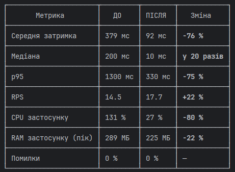
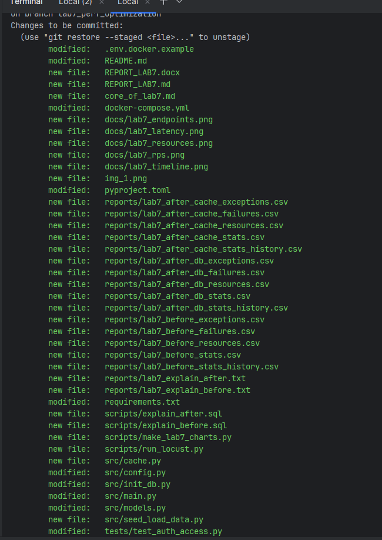

Суть роботи                                                                                                                                                                                                                       
                                                                                                                                                                                                                                    
  Потрібно було знайти, що найбільше гальмує сервіс петицій, виправити це і довести результат тим самим навантажувальним тестом, що в ЛР4.                                                                                          
                                                                                                                                                                                                                                    
  1. Підготувала середовище, схоже на реальне. Окремий Docker-проєкт, щоб не зачепити основну БД (docker compose -p petitions-lab7 -f docker-compose.yml up -d --build). У базу додано 200 петицій і 15 тис. голосів, з них 10 000  
     на вірусній петиції №1 (docker compose -p petitions-lab7 exec web python -m src.seed_load_data).                                                                                                                               
  2. Виміряла «ДО». Той самий профіль Locust, що в ЛР4: сплеск до 40 користувачів за 60 с. Паралельно знімалися CPU і RAM (python scripts/run_locust.py before; всередині locust -f locustfile.py --headless --host http://localhost
     --csv reports/lab7_before і docker stats --no-stream кожні ~2 с).                                                                                                                                                              
  3. Знайшла вузьке місце.                                                                                                                                                                                                          
     - Сама база відповідала швидко, за ~1.6 мс (docker compose -p petitions-lab7 exec -T db psql -U petitions -d petitions < scripts/explain_before.sql → reports/lab7_explain_before.txt).                                        
     - Справжня проблема була в коді: щоб показати лише кількість голосів, сервер тягнув у Python усі 10 000 записів (у коді: selectinload(Petition.votes) + len(petition.votes)).                                                  
  4. Виправила в три кроки:                                                                                                                                                                                                         
     - Запит. База сама рахує голоси і повертає 1 рядок замість 10 000 (функція petitions_query() у src/main.py: select(func.count(Vote.id)).where(Vote.petition_id == Petition.id).scalar_subquery()).                             
     - Кеш Redis. Записи живуть 30 с, після голосу кеш очищається (новий файл src/cache.py: redis.set(key, json, ex=30); сервіс redis: image: redis:7-alpine у docker-compose.yml; cache_delete(...) після успішного голосу).       
     - Індекси (src/models.py і CREATE INDEX IF NOT EXISTS ix_petitions_created_at ..., ... ix_votes_petition_user ON votes (petition_id, user_id) в init_db.py).                                                                   
  5. Виміряла «ПІСЛЯ» двічі, щоб побачити внесок кожного кроку:                                                                                                                                                                     
     - без Redis (REDIS_URL="" docker compose -p petitions-lab7 -f docker-compose.yml up -d --build → python scripts/run_locust.py after_db);                                                                                       
     - з Redis (docker compose -p petitions-lab7 -f docker-compose.yml up -d → python scripts/run_locust.py after_cache).                                                                                                           
  6. Перевірила, що нічого не зламалось. Усі 13 тестів проходять, серед них новий тест на правильну кількість голосів (venv\Scripts\python -m pytest -q; ruff check src tests).                                                     
  7. Оформила результати: графіки, звіт і Word-файл (python scripts/make_lab7_charts.py → docs/lab7_*.png; REPORT_LAB7.md; REPORT_LAB7.docx через python-docx).                                                                     
                                                                                                                                                                                                                                    
  Головні результати (ДО → ПІСЛЯ)    
  

Цифри взято з рядка Aggregated у reports/lab7_*_stats.csv і з *_resources.csv.                                                                                                                                                    
                                                                                                                                                                                                                                    
  - Відкриття вірусної петиції стало в 42 рази швидшим: медіана 210 → 5 мс (з тих самих CSV, рядок GET /petitions/{viral_id}).                                                                                                      
  - Кеш працює: 99.4 % читань пішли з кешу (docker compose -p petitions-lab7 exec redis redis-cli INFO stats → keyspace_hits:639, keyspace_misses:4).                                                                               
  - Індекси справді використовуються: у планах з'явилися Index Scan Backward using ix_petitions_created_at і ix_votes_petition_user (scripts/explain_after.sql → reports/lab7_explain_after.txt).                                   
                                                                                                                                                                                                                                    
  Головний висновок                                                                                                                                                                                                                 
                                                                                                                                                                                                                                    
  Найбільший приріст дала оптимізація запиту (COUNT() замість завантаження всіх голосів), близько 97 % усього виграшу в середній затримці. Це видно з порівняння прогонів: after_db проти before дає 379 → 101 мс.                  
                                                                                                                                                                                                                                    
  Redis дав додаткове покращення, найбільше на «хвостах» затримки і на навантаженні БД: p95 зменшився з 460 до 330 мс, CPU PostgreSQL з 5 % до 2.8 % (порівняння after_cache з after_db).                                           
                                                                                                                                                                                                                                    
  Індекси майже не вплинули на тест, бо даних поки мало. Але вони знадобляться, коли база виросте.   
  

скільки файлів було змінено:

